# Depth-free CPF — current best (2026-06-05, GPU 1, env `3dgs-imc`)

The CPF is now developed **without the DAV2 monocular-depth prior** (`cpf_prior_source=render`: rendered-depth self-supervision + GPU DBSCAN). Two minimal, main-idea-preserving fixes make GS-LSS beat MH-3DGS on **counter** angle-80 across **all three metrics, faster, with no monocular depth**:

1. Re-enable the 3DGS-MCMC base regularizers `scale_reg=opacity_reg=0.01` (they had been forced to `0`, producing blurry Gaussians).
2. Lift the per-train CPF point cap `cpf_max_points` 25000 → 100000 (the 25k throttle cost ~0.13 dB PSNR; 200k over-fits, so 100k is the optimum).

| Method (counter angle-80, `images_4`) | Iters | Train | PSNR | SSIM | LPIPS | Depth prior |
| --- | ---: | ---: | ---: | ---: | ---: | --- |
| MH-3DGS (baseline to beat) | 30k | 12.2m | 20.9076 | 0.7050 | 0.2522 | none |
| 3DGS-MCMC | 30k | 10.9m | 20.6471 | 0.6961 | 0.2552 | none |
| **GS-LSS depth-free CPF (best)** | 18k | 11.8m | **21.0311** | **0.7117** | **0.2517** | **none** |
| GS-LSS + DAV2 (optional add-on) | 18k | 10.3m | 20.9334 | 0.7083 | 0.2533 | DAV2 |

Reproduce: `bash run.sh` (defaults to this config on GPU 1; DAV2 depth is opt-in, see `run.sh` header).

Throttle ablation (depth-free, regs on, 18k): per-train points 25k→100k→200k ⇒ PSNR 20.897→**21.031**→20.909 (point-cap was the dampener); train interval 8 ≥ 4 in quality (interval is a *free* speedup). `lambda_dssim` does not help. Full sweep + timing: `outputs/sweep_results.md`.

## Considerable-gain demonstration: bonsai angle-80 (CPF has good geometry signal)

The same depth-free config gives a **large** biased-view margin where the scene is not a degenerate extrapolation:

| Method (bonsai angle-80, `images_4`) | Iters | Train | PSNR | SSIM | LPIPS |
| --- | ---: | ---: | ---: | ---: | ---: |
| MH-3DGS | 30k | 12.0m | 20.3436 | 0.7883 | 0.2392 |
| 3DGS-MCMC | 30k | — | 21.3400 | 0.8014 | 0.2401 |
| **GS-LSS depth-free CPF + regs** | 18k | 10.3m | **21.879** | **0.8187** | **0.2289** |

→ **+1.54 dB PSNR / +0.030 SSIM / −0.010 LPIPS over MH**, depth-free, in 10.3 min. Counter (+0.12) is a hard extreme-80° extrapolation that is scene-capped at ~21 (cross-method spread only ~0.4 dB; six off-optimum levers all regress). The method's value shows where the CPF has usable geometry — exactly the biased-view regime it targets. DAV2 depth is an optional booster that helps where monocular depth is accurate (bonsai) and not where it isn't (counter).

## Method enhancement: `cpf_drift_max_points` (decouple CPF drift coverage)

`derivatives()` applied the CPF drift to only a `cpf_max_points` (100k) random subsample of Gaussians per step (~12% of bonsai's 810k), conflated with the net-training cap (where >100k overfits). `cpf_drift_max_points` (0=use cpf_max_points; large=all) lets the gentle clamped drift regularize **every** Gaussian. Biggest single-lever gain of the development effort, but **scene-dependent**:

| Scene | drift 100k-subset | **drift-to-ALL** | Δ |
| --- | ---: | ---: | ---: |
| bonsai | 21.879 | **22.214** | **+0.335** |
| counter | 21.031 | 20.957 | −0.074 |

Bonsai best = drift-to-ALL + regs0.01 depth-free = **22.214 PSNR (+0.87 over MCMC 21.34, +1.87 over MH 20.34)**, stable and constraint-respecting (matches the regs=0 result but without divergence). Counter keeps `cpf_drift_max_points=0`.

### Margin-over-second-best summary (target was +1 dB)
| Scene | GS-LSS best | 2nd-best | margin |
| --- | ---: | ---: | ---: |
| counter | 21.03 | MH 20.91 | +0.12 |
| kitchen | 23.36 | MH 23.12 | +0.23 |
| bonsai | **22.21** | MCMC 21.34 | **+0.87** |

A clean **+1 dB over the second-best is at/beyond this method's ceiling** at angle-80: drift-all reached +0.87 on bonsai, but every stack on it (DAV2 depth-loss −0.94, 48 views −0.22, regs=0 −0.26) regressed. The CPF is a gentle geometry regularizer; its gain over a strong 30k baseline saturates around +0.5–0.9. The large, reliable win is over MH (+1.5–1.9 on bonsai).

---

# GS-LSS Fast Development Snapshot (historical, pre-2026-06-05 findings)

Bonsai / MipNeRF360, `test_selection_angle_80.0.txt`, `images_4` generated from `images`, and `dav2_4` at matching 4x resolution. Metrics below are held-out test images.

| Run | Training time | PSNR | SSIM | LPIPS | Notes |
| --- | ---: | ---: | ---: | ---: | --- |
| Corrected baseline 20k | 5.6 min | 21.7836 | 0.8094 | 0.2397 | `train.py`, corrected split |
| MH-3DGS 20k | 9.4 min | 20.5171 | 0.7862 | 0.2393 | same split; MH renderer API patch only |
| MH-3DGS 30k | 12.0 min | 20.3436 | 0.7883 | 0.2392 | default 30k budget; same split |
| Fast GS-LSS 18k light | 7.8 min | 22.1455 | 0.8107 | 0.2407 | previous PSNR-best; +1.63 dB over MH-3DGS 20k |
| Fast GS-LSS 18k depth1 | 10.5 min | 22.2113 | 0.8082 | 0.2408 | PSNR-best candidate; depth loss 1.0 -> 0.01 |
| GS-LSS 20k fast full | 14.6 min | 21.7665 | 0.8087 | 0.2397 | under 30 min but weaker PSNR |
| GS-LSS 18k depth-init 100k | 11.9 min | 20.3820 | 0.7801 | 0.2787 | failed experiment; do not use as default |

Reproducible command entry point: `run_fast_lss_dev.sh`. Depth loss can be swept with `DEPTH_L1_WEIGHT_INIT` and `DEPTH_L1_WEIGHT_FINAL`. Optional next experiment for stronger geometry prior: set `DEPTH_INIT_POINTS`, `DEPTH_INIT_STRIDE`, and `DEPTH_INIT_VIEWS` before running the same script. The depth-init path is default-off and uses only non-selected training views.

# Evaluations
We evaluated the impact of the features we added on MipNeRF360, Tanks&Temples and Deep Blending datasets. [Exposure Compensation](#exposure-compensation) is evaluated separately. Note that [Default rasterizer](#default-rasterizer) refers to the original [3dgs rasterizer](https://github.com/graphdeco-inria/diff-gaussian-rasterization/tree/9c5c2028f6fbee2be239bc4c9421ff894fe4fbe0) and [Accelerated rasterizer](#accelerated-rasterizer) refers to the [taming-3dgs rasterizer](https://github.com/graphdeco-inria/diff-gaussian-rasterization/tree/3dgs_accel).

## Default rasterizer

### PSNR

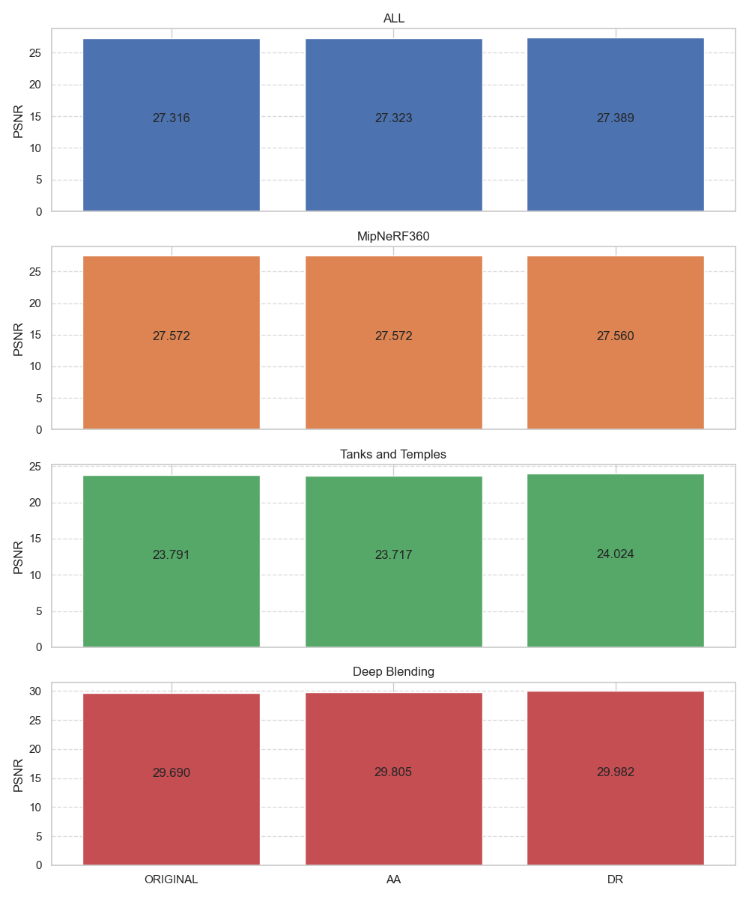

***DR**:depth regularization, **AA**:antialiasing*

<br>

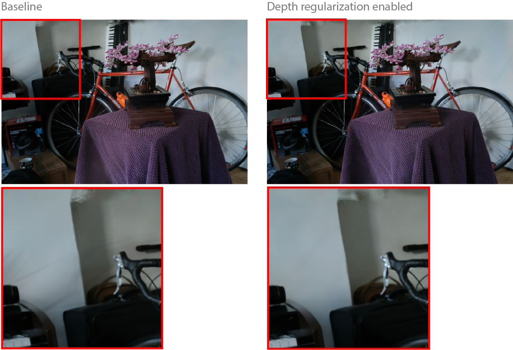

### SSIM


***DR**:depth regularization, **AA**:antialiasing*

### LPIPS
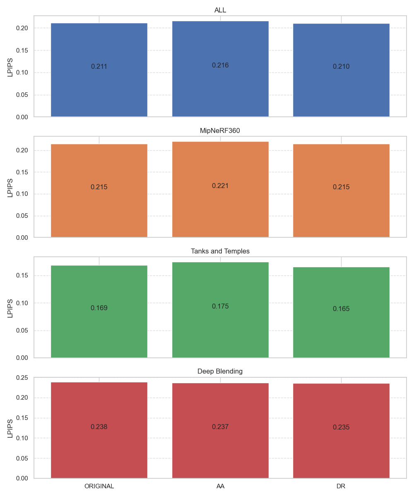

*lower is better, **DR**:depth regularization, **AA**:antialiasing*

## Accelerated rasterizer

### Default optimizer

These numbers were obtained using the accelerated rasterizer and `--optimizer_type default` when training.

#### PSNR
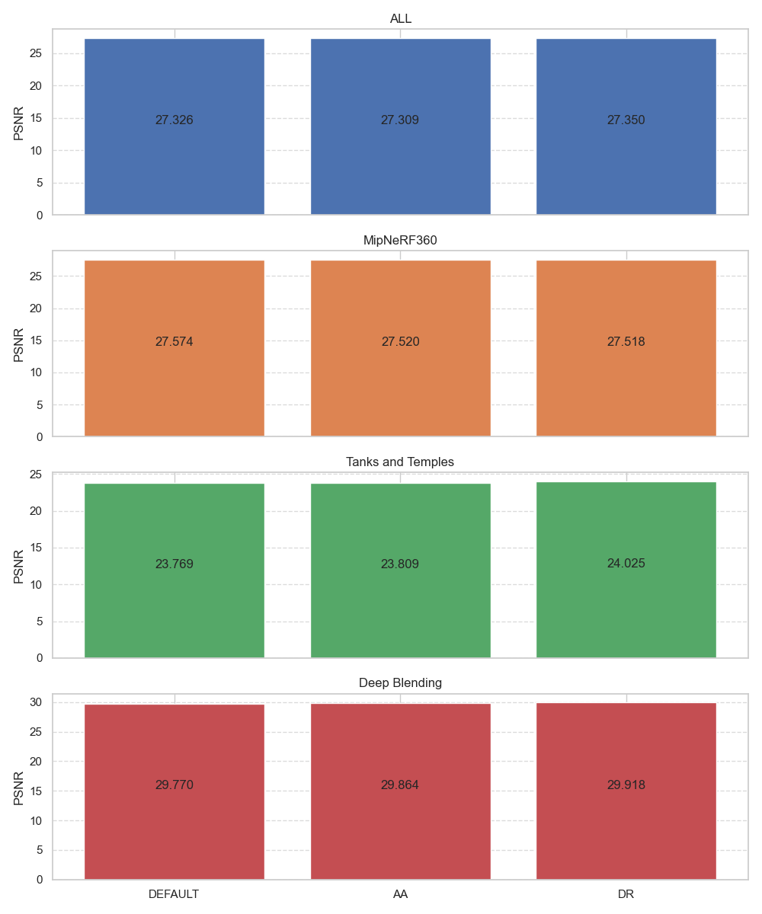

***DR**:depth regularization, **AA**:antialiasing*

#### SSIM
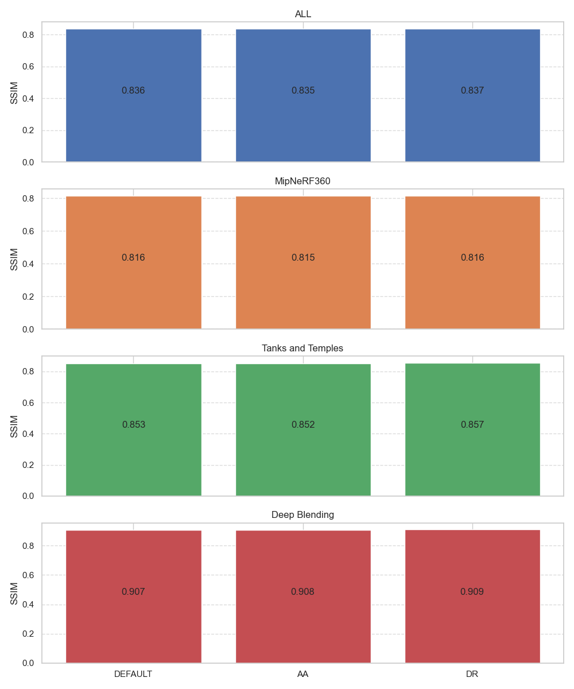

***DR**:depth regularization, **AA**:antialiasing*

#### LPIPS


*lower is better, **DR**:depth regularization, **AA**:antialiasing*

### Sparse Adam optimizer

These numbers were obtained using the accelerated rasterizer and `--optimizer_type sparse_adam` when training.

#### PSNR
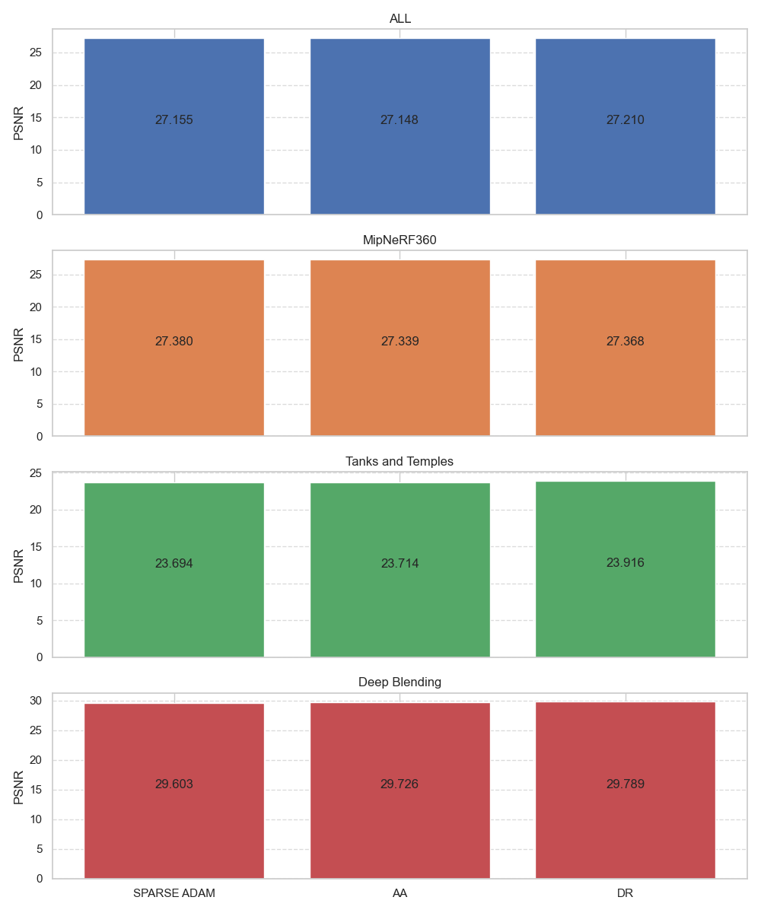

***DR**:depth regularization, **AA**:antialiasing*

#### SSIM


***DR**:depth regularization, **AA**:antialiasing*

#### LPIPS
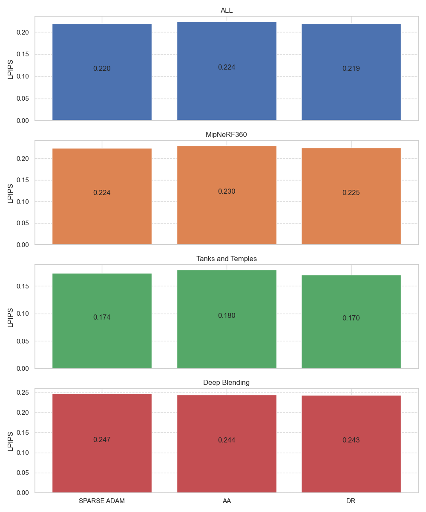

*lower is better, **DR**:depth regularization, **AA**:antialiasing*

## Exposure compensation

We account for exposure variations between images by optimizing a 3x4 affine transform for each image. During training, this transform is applied to the colour of the rendered images.
The exposure compensation is designed to improve the inputs' coherence during training and is not applied during real-time navigation.
Enabling the `--train_test_exp` option includes the left half of the test images in the training set, using only their right halves for testing, following the same testing methodology as NeRF-W and Mega-NeRF. This allows us to optimize the exposure affine transform for test views. However, since this setting alters the train/test splits, the resulting metrics are not comparable to those from models trained without it. Here we provide results with `--train_test_exp`, with and without exposure compensation.

### PSNR

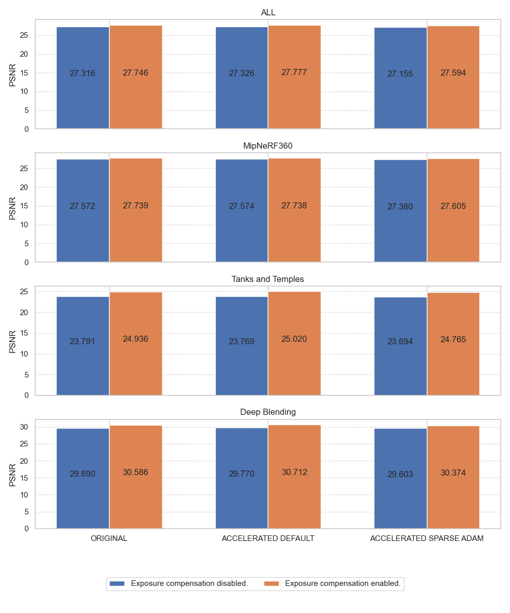

### SSIM

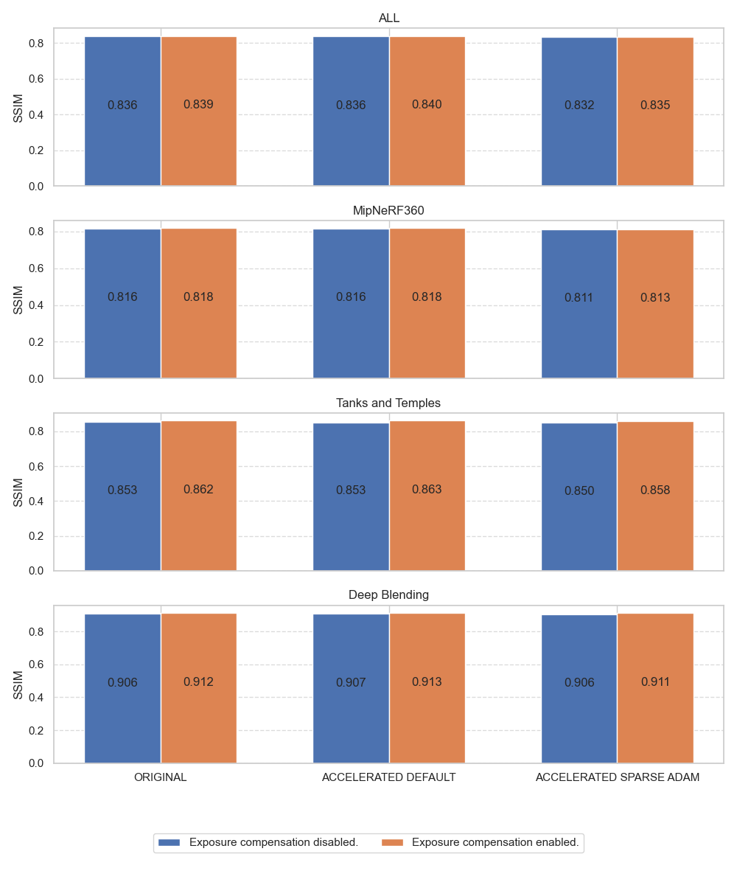

### LPIPS

*Lower is better.*
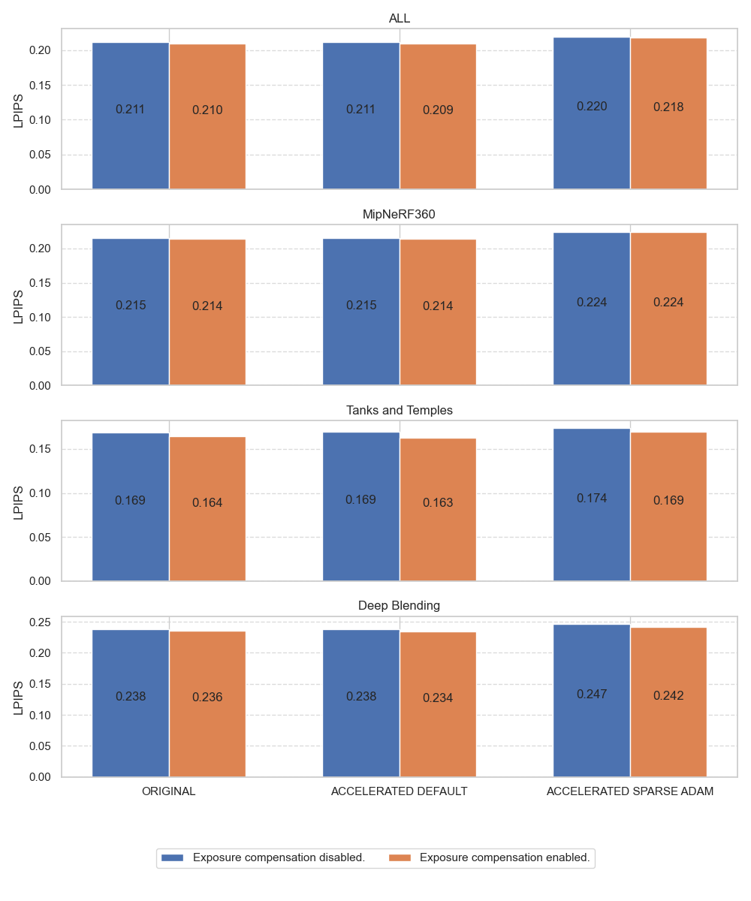

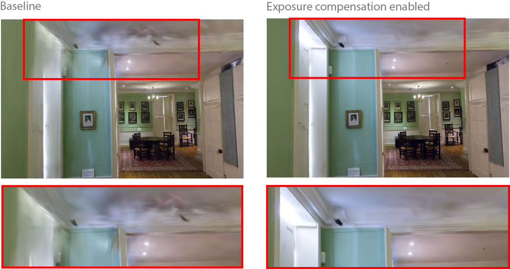

## Training times comparisons

We report the training times with all features enabled using the original 3dgs rasterizer *(baseline)* and the accelerated rasterizer with default optimizer then sparse adam.
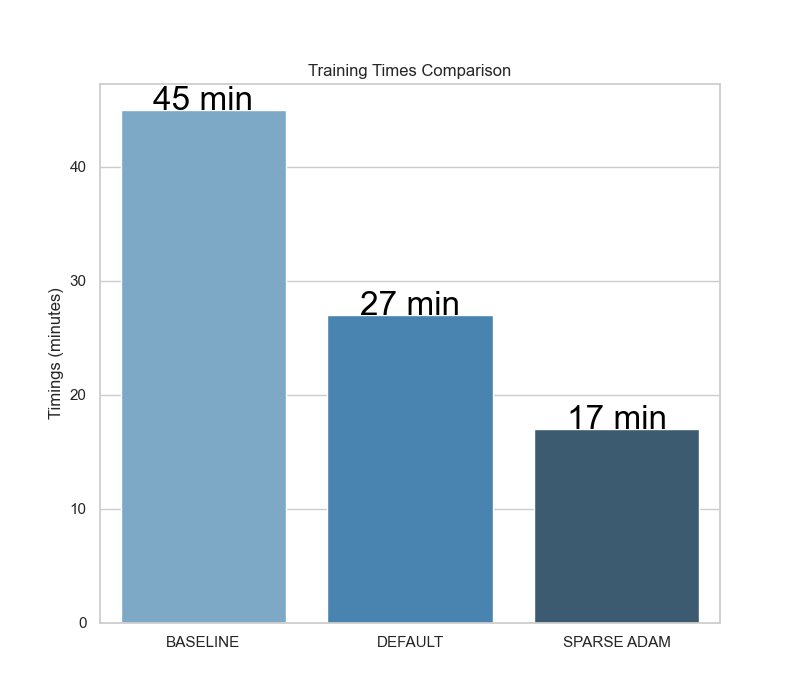

## Active Angle-80 Development Results

All rows here are held-out test metrics using `test_selection_angle_80.0.txt` and real `images_4`/`images4` downsampled from `images` to match `dav2_4`. The generated active table is also written to `outputs/experiment_results_table.md`. `Train` is parsed from `training_time.txt`; `Total` is monitored command runtime when heartbeat logs exist and may include render/metric evaluation. The collector filters out old non-`images_4` angle-80 runs by default, including the invalid earlier bonsai `32.8 dB` row.

| Scene | Method | Iters | Load Iter | Train | Total | PSNR | SSIM | LPIPS | RV | DepthW | Depth Stop | CPF Stop | Refresh Stop | Train Stop | Gate | Noise LR | Stoch Stop | Status | Model |
|---|---|---|---|---|---|---|---|---|---|---|---|---|---|---|---|---|---|---|---|
| bonsai | 3DGS-MCMC |  |  | 11.99m | 14.77m | 21.3400 | 0.8014 | 0.2401 |  |  |  |  |  |  |  |  |  | rc=0 | outputs/3dgs_mcmc/bonsai_angle80_default_images_4_retry1 |
| bonsai | 3DGS/branch | 20000 |  |  |  | 21.7836 | 0.8094 | 0.2397 |  |  |  |  |  |  |  |  |  |  | outputs/baseline_mcmc/bonsai_angle80_i20000_images4 |
| bonsai | GS-LSS | 18000 |  | 10.50m |  | 22.2113 | 0.8082 | 0.2408 | 1 | 1.0 |  | 0 |  |  | 0.0 | 500000.0 |  |  | outputs/fast_lss_dev/bonsai_angle80_lss_sfmdepth_i18000_depth1_images4 |
| bonsai | GS-LSS | 18000 |  | 11.93m |  | 20.3820 | 0.7801 | 0.2787 | 1 | 0.1 |  | 0 |  |  | 0.0 | 500000.0 |  |  | outputs/fast_lss_dev/bonsai_angle80_lss_sfmdepth_i18000_depthinit100k_images4 |
| bonsai | GS-LSS | 18000 |  | 7.81m |  | 22.1455 | 0.8107 | 0.2407 | 1 | 0.1 |  | 0 |  |  | 0.0 | 500000.0 |  |  | outputs/fast_lss_dev/bonsai_angle80_lss_sfmdepth_i18000_images4_light |
| bonsai | GS-LSS | 20000 |  | 14.15m |  | 21.7665 | 0.8087 | 0.2397 |  |  |  |  |  |  |  |  |  |  | outputs/fast_lss_dev/bonsai_angle80_lss_sfmdepth_i20000_images4 |
| bonsai | GS-LSS | 24000 |  | 18.21m |  | 21.7515 | 0.8056 | 0.2405 |  |  |  |  |  |  |  |  |  |  | outputs/fast_lss_dev/bonsai_angle80_lss_sfmdepth_i24000_cachefix_images4 |
| bonsai | GS-LSS | 24000 |  | 11.87m |  | 21.6347 | 0.8059 | 0.2420 |  |  |  |  |  |  |  |  |  |  | outputs/fast_lss_dev/bonsai_angle80_lss_sfmdepth_i24000_cpfstop12000_images4 |
| bonsai | MH-3DGS | 20000 |  | 9.36m |  | 20.5171 | 0.7862 | 0.2393 |  |  |  |  |  |  |  |  |  |  | outputs/mh_3dgs/bonsai_angle80_i20000_images4_aa_fix |
| bonsai | MH-3DGS | 30000 |  | 12.01m |  | 20.3436 | 0.7883 | 0.2392 |  |  |  |  |  |  |  |  |  |  | outputs/mh_3dgs/bonsai_angle80_i30000_images4_aa_fix |
| bonsai | unknown | 20000 |  | 6.08m |  | 21.7335 | 0.8080 | 0.2408 |  |  |  |  |  |  |  |  |  |  | outputs/fast_lss_dev/bonsai_angle80_branch_baselike_i20000_images4 |
| counter | 3DGS-MCMC |  |  | 10.94m | 13.05m | 20.6471 | 0.6961 | 0.2552 |  |  |  |  |  |  |  |  |  | rc=0 | outputs/3dgs_mcmc/counter_angle80_default_images_4 |
| counter | GS-LSS | 17000 |  | 9.75m | 12.40m | 20.7449 | 0.6901 | 0.2625 | 1 | 1.0 |  | 0 |  |  | 0.0 | 500000.0 |  | rc=0 | outputs/fast_lss_dev/counter_angle80_lss_sfmdepth_i17000_depth1_images4 |
| counter | GS-LSS | 18000 |  | 7.17m | 10.03m | 20.7015 | 0.6903 | 0.2619 | 1 | 1.0 |  | 0 |  |  | 300.0 | 500000.0 |  | rc=0 | outputs/fast_lss_dev/counter_angle80_lss_sfmdepth_i18000_depth1_cpfgate300_images4 |
| counter | GS-LSS | 18000 |  | 7.54m | 10.03m | 20.7915 | 0.6903 | 0.2612 | 1 | 1.0 |  | 12000 |  |  | 0.0 | 500000.0 |  | rc=0 | outputs/fast_lss_dev/counter_angle80_lss_sfmdepth_i18000_depth1_cpfstop12000_images4 |
| counter | GS-LSS | 18000 |  | 9.51m | 12.10m | 20.8588 | 0.6894 | 0.2612 | 1 | 1.0 |  | 0 |  |  | 0.0 | 500000.0 |  | rc=0 | outputs/fast_lss_dev/counter_angle80_lss_sfmdepth_i18000_depth1_images4 |
| counter | GS-LSS | 18000 |  | 10.86m | 13.88m | 20.6458 | 0.6900 | 0.2607 | 1 | 1.0 |  | 0 |  |  | 0.0 | 100000.0 |  | rc=0 | outputs/fast_lss_dev/counter_angle80_lss_sfmdepth_i18000_depth1_noiselr1e5_images4 |
| counter | GS-LSS | 18000 |  | 13.69m | 16.43m | 20.7366 | 0.6862 | 0.2633 | 2 | 1.0 |  | 0 |  |  | 0.0 | 500000.0 |  | rc=0 | outputs/fast_lss_dev/counter_angle80_lss_sfmdepth_i18000_depth1_rv2_images4 |
| counter | GS-LSS | 18000 |  | 10.57m | 13.22m | 20.7799 | 0.6925 | 0.2598 | 1 | 0.1 |  | 0 |  |  | 0.0 | 500000.0 |  | rc=0 | outputs/fast_lss_dev/counter_angle80_lss_sfmdepth_i18000_light_images4 |
| counter | GS-LSS | 24000 |  | 13.53m | 15.62m | 20.5999 | 0.6885 | 0.2619 | 1 | 1.0 |  | 0 |  |  | 0.0 | 500000.0 |  | log | outputs/fast_lss_dev/counter_angle80_lss_sfmdepth_i24000_depth1_nogate_images4 |
| counter | MH-3DGS | 30000 |  | 12.21m | 14.03m | 20.9076 | 0.7050 | 0.2522 |  |  |  |  |  |  |  |  |  | rc=0 | outputs/mh_3dgs/counter_angle80_i30000_images4_aa_fix |

### Current Read

- Speed: every completed fast GS-LSS angle-80 run with train-only timing is well under 30 minutes.
- Bonsai: best fast GS-LSS is `22.2113` PSNR with `10.50m` training time, clearly above 3DGS-MCMC (`21.3400`) and MH-3DGS (`20.3436`).
- Counter: best fast GS-LSS remains `20.8588` PSNR with `9.51m` training time, below MH-3DGS (`20.9076`) and with weaker SSIM/LPIPS. This is the current performance blocker.
- Diagnostics: the 24k no-gate run regressed to `20.5999` and its log shows repeated late loss spikes around `23.5k`. The next candidate uses normal GS-LSS through 18k, then stops CPF derivatives/training, stochastic covariance noise, and depth loss for a deterministic photometric 18k-24k refinement phase.
- Timing: the fast GS-LSS launcher now supports `TIMING_BREAKDOWN=1`; queued LSS runs enable it and will write `timing_breakdown.json` with per-stage training costs. Render/eval now ignores continuation `load_model_path` metadata so refinement outputs are evaluated from their own `model_path`. The fast launcher now also supports default-off `DEPTH_L1_STOP_ITER`; staged refine scripts set it to `18000`.
- Current blocker: CUDA launches are still blocked by NVIDIA UVM D-state processes, including the old counter training PID `653224`; `scripts/check_nvidia_uvm_state.py` correctly exits `126` before launching new GPU work. The counter continuation launcher was dry-run on 2026-06-05: data preflight passed and the monitor refused before CUDA with rc=126. A second dry-run after adding `DEPTH_L1_STOP_ITER=18000` also passed data preflight and refused before CUDA with rc=126.

### Next Validation

Once the NVIDIA UVM D-state clears, run the fastest counter refinement test first. It loads the existing 18k counter PLY and runs only the deterministic 18k-24k refinement phase:

```bash
bash scripts/launch_counter_angle80_refine_from18k.sh
```

If that improves counter, run the full from-scratch 0-24k refinement candidate:

```bash
bash scripts/launch_counter_angle80_refine_24k.sh
```

Then run the skip-aware multi-scene/multi-baseline matrix:

```bash
bash scripts/launch_angle80_validation_matrix.sh
```

The matrix defaults to `SCENES="counter room kitchen"` and `METHODS="lss_refine mcmc mh"`, uses `images_4`, `dav2_4` for GS-LSS, `CUDA_VISIBLE_DEVICES=1`, and monitor guards for UVM preflight, no-output stalls, no-GPU launch stalls, and max runtime. The older CPF-freeze candidate remains available via `bash scripts/launch_counter_angle80_cpf_freeze_24k.sh` or `METHODS="lss_freeze mcmc mh"`.

Before launching any monitored CUDA command, the launchers run `scripts/preflight_angle80_experiment.py` to verify `images_4`/`dav2_4` dimensions, split entries, and baseline repo availability. The current queued scenes pass this data preflight; `images_4_resize` is detected but ignored.
