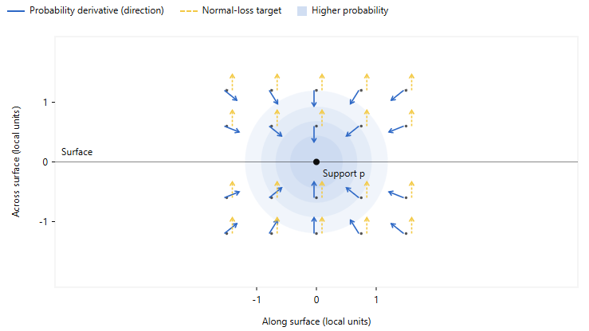
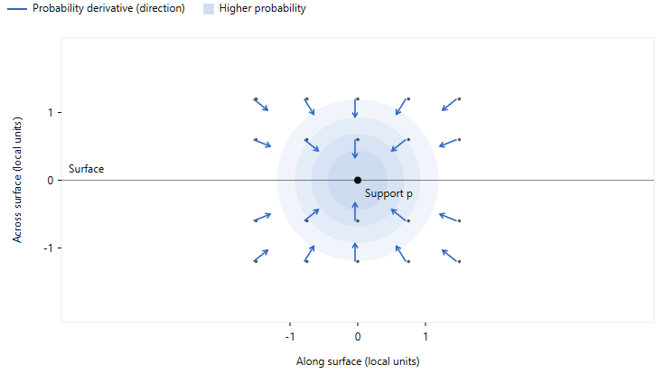
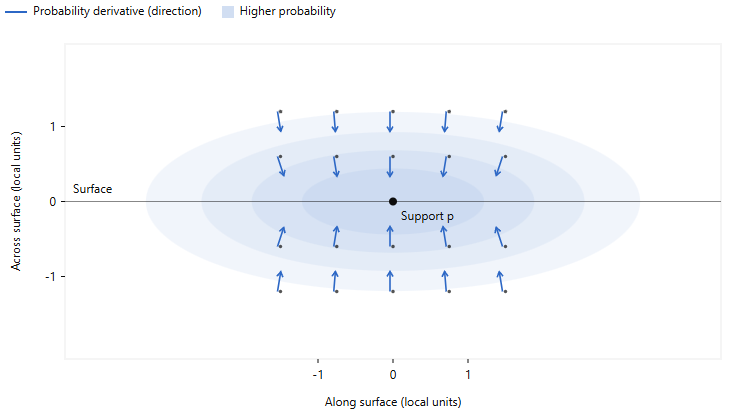

# Reviewer Comments Reading and Revision Planning

Updated on 29 September 2026 to match the agreed discussion and the [full revision plan](../../tvcg-major-revision-2026-09-28/CONSOLIDATED_REVISION_PLAN.md).

The agreed R1.5 study uses **two alternative splits** for all eight Mip-NeRF 360 scenes at a 60° gap and both Tanks & Temples scenes under discontinuous coverage: **40 additional runs** for GS-LSS and 3DGS-MCMC at one training seed. The original-split references are shared with compatible revised-main-table work.

This update records the plan only. Revision training, evaluation, implementation changes and manuscript edits remain deferred. We will choose the final R1.2 formulation before running the larger revision studies. Keep all attempts and record the actual configurations, checkpoint sources, metrics and selection rules; unknown historical settings remain unknown.

## Reviewer 1

*This paper presents GS-LSS, a stochastic optimization framework for 3D Gaussian Splatting under biased viewpoint distributions. The method constructs a Continuous Probability Field from intermediate 3DGS geometry and uses its gradients to guide Gaussian relocation and reshaping, while a learned variance module controls stochastic perturbations.*

#### *1.1 Its supervision is obtained from RGB, depth, and normals rendered by the same Gaussian model trained on biased views. The paper does not isolate this effect through comparisons with fixed SfM support, external depth, or oracle geometry.*

- What it means: prove CPF is a **useful regularization**. The current albations of DBSCAN, CPF model architecture cannot fully explain if the CPF works a global regularization. There should be evidence to proof if CPF is actually beneficial for biased sampling.

- what to do: We may need to ablate CPF alone, with the following setups.

| Configuration | What it establishes |
|---|---|
| Same underlying optimizer with CPF disabled | The benefit attributable to CPF |
| CPF from fixed training-view SfM support | Whether existing sparse observations already provide sufficient guidance |
| CPF from rendered support frozen after warm-up, while CPF weights remain trainable | Whether aggregation of the model’s initial geometry helps |
| CPF from periodically refreshed rendered support, with continued CPF training | Whether updating the support helps |
| CPF weights frozen after a common warm-up, while the field is still queried | Whether updating the CPF network helps; share this control with R1.6 |
| CPF from ground-truth geometry visible through the same training cameras | How support accuracy limits the method |
| External predicted depth, as an extension | Whether an independent estimator offers a practical alternative |

- what metrics to use: Geometry accuracy, image quality.

- shared control: **fixed support and fixed CPF weights are different comparisons**. Keep both explicit. Use the same optimizer, warm-up and other relevant settings for the frozen-versus-updated CPF comparison. R1.1 owns this control, so it is not counted again under R1.6.

#### *1.2 Equation (21) assigns an isotropic Gaussian probability around each point, while Equation (22) forces the probability gradient to align with an oriented surface normal. Thus, the stated probability model and normal constraint cannot generally be satisfied simultaneously.*

- what it means: **A conflict** between the consistant normal direction and the isotropic Gaussian directions. 

- what to do (solution 1): remove the conflicting normal-gradient loss, keeping the isotropic probability target and other loss settings unchanged. CPF and its input gradient still guide Gaussian optimization.

- what to do (solution 2): replace the normal objective with the following formulation.
For the surface-aware replacement we discussed, we change both the probability target and the gradient target.
For a locally flat patch with unit normal $n$ and positive bandwidth $h$, let $d=n^{\top}(x-p)$. Define:
$$
P^{*}(x)=e^{-d^{2}/(2h^{2})},\qquad
g^{*}(x)=\nabla P^{*}(x)=-\frac{d}{h^{2}}P^{*}(x)\,n.
$$

- how to choose: **test both removal and replacement in a matched pilot, then use the better supported solution**. The replacement uses the full derived gradient above, including its zero value at the surface. It is a local surface target, not a learned global signed-distance field.

- shared normal-loss control: if the replacement is selected, compare its gradient loss on versus off while keeping the same $P^*(x)$ and other settings. Comparing the original removal with the replacement alone changes both the scalar target and gradient supervision. If removal is selected, reuse the original-versus-removal comparison. This work answers the normal-loss part of R1.6.

- retraining: choose the solution first, then regenerate all affected GS-LSS main-table and ablation results for that final formulation. Reuse compatible unchanged baseline models. We do not need to train both candidate solutions for every paper configuration.

#### *1.3 Equation (17) does not correspond to Langevin sampling of Equation (28), since the learned drift and variance do not satisfy the required noise-drift relationship and no correction step is used. The claimed methodological distinction from heuristic stochastic 3DGS is therefore limited.*

- what it means: clarify the **theoretical claim** and explain **the methodological distinction** from stochastic 3DGS. Having a learnable mean and variance makes the update adaptive, but does not by itself show that Eq. (17) samples the distribution associated with Eq. (28).

- agreed approach: retain the basic objective and clarify the method. We do not need a new exact sampler or stronger sampling claims to answer this comment.

- what to do:
    1. **Keep the basic form of Eq. (28)**: photometric loss plus CPF-support regularization. Explain it as the optimization objective. Changing this equation alone cannot establish the required relationship between the drift and noise in Eq. (17).
    2. **Check how Eq. (28) corresponds to Eq. (17)**. Verify the support-loss weight, applied drift coefficient, learning rates, averaging factors, signs and optimizer behavior against the selected implementation. Use separate notation where necessary. This is a planned consistency check, not a decision to change training coefficients.
    3. **Explain Eq. (17) as CPF-guided learned stochastic optimization**. Langevin dynamics motivate the design, but we do not claim that the update samples Eq. (28)'s Gibbs distribution. The submission already contains a disclaimer, so make the surrounding derivation, algorithm and contribution wording consistent too. A missing MH correction is not by itself proof that every Langevin method is invalid.
    4. **Explain the actual difference from 3DGS-MCMC**: the aggregated support field, its additional gradient guidance, and the verified learned support/state-conditioned noise. MCMC already uses deterministic photometric-gradient updates and state-dependent noise; its added zero-mean noise does not mean its whole update has zero mean. Check which heads and gradient paths are active in the configuration we report.
    5. **Reuse Table V as empirical support**, with a limited interpretation. The full variant has the best submitted PSNR/LPIPS, while the learned-noise-only variant has the best SSIM. The latter also changes the support input, so it is not a perfectly matched drift-off comparison. These results do not prove Langevin sampling.

- experiments and shared work: no additional R1.3 ablation suite or retraining is needed by default for a clarification of the unchanged algorithm. Table V provenance and any regeneration after R1.2 remain shared work. Share the method comparison with R2.2, the result explanation with R2.3 and the sign audit with R3.3. Any actual implementation discrepancy needs separate validation. **This approach is accepted; implementing the revision remains deferred.**

#### *1.4 PSNR, SSIM, and LPIPS on held-out images do not establish better global scene structure. The proposed FFR metric measures distance from sparse training-view SfM points and may classify legitimate surfaces outside the observed support as floaters. Evaluation against ground-truth depth, point clouds, meshes, or rendered depth is needed.*

- what it means: scene structure accuracy **only evaluated** from sparse SfM is not enough. 

- what to do: use **ground-truth depth**, such as MatrixCity, to evaluate geometry accuracy against other baselines. Validate camera alignment, depth units/convention and common masks first. Reuse compatible checkpoints; adding a geometry metric alone does not require retraining.

- what metircs to use: RMSE, depth error map.

#### *1.5 The exact view counts, random seeds, discontinuous-region selection, per-scene results, and variance across splits are not reported. Five repeated trials on one setting do not address split sensitivity.*

- what it means: need to provide evidence to prove that the **train/test split** does not depend on **one favorable missing-camera region**.

- what to do:
    1. In the main paper, add a concise protocol description, essential counts and selection rules, plus one compact table or plot summarizing split sensitivity.
    2. Put detailed per-scene/per-split results, exact image lists and view counts, split/training seeds, full configurations with explicit exceptions, and checkpoint mappings directly in the response letter. Use readable tables/text and an appendix within the same response PDF.
    3. Provide a stable, versioned link to machine-readable CSV/JSON/configuration files and checkpoints where feasible. These support replication; the response PDF should contain the evidence needed to assess our answer without depending on separate file uploads.

- agreed split study: **two new alternatives per scene**, together with the original reference split. Use final GS-LSS and 3DGS-MCMC, with one declared training seed per configuration.

| Study | Scenes | Alternative splits per scene | Methods | Training seeds | Additional runs |
|---|---|---:|---|---:|---:|
| 60° contiguous gap | All 8 Mip-NeRF 360 scenes | 2 gap centers | GS-LSS and 3DGS-MCMC | 1 | 32 |
| Discontinuous coverage | Truck and Train from Tanks & Temples | 2 region selections | GS-LSS and 3DGS-MCMC | 1 | 8 |
| Total | 10 scene/protocol cases | 2 | 2 methods | 1 | **40** |

- reference reuse: the 10 original-split cases need 20 reference models across the two methods. Share them with compatible revised-main-table work, giving 60 model configurations including references. The 40 additional runs exclude any needed reference regeneration, other revision studies and retries. Use the final R1.2 formulation on both original and alternative splits; old GS-LSS results from a different loss are not matched references.

- comparison details: keep the 60° width fixed and move the gap center. For discontinuous coverage, change the selected regions while keeping their number and view counts comparable. Save exact image lists and seeds. Keep each method's per-scene recipe, checkpoint and selection rules fixed across splits, and train each new split separately.

- what to report: per-scene results, variation across the three splits, dataset-level summaries and paired GS-LSS–MCMC differences. Report the Mip-NeRF 360 gap study and Tanks & Temples discontinuous study separately, including unfavorable outcomes. One training seed tests split sensitivity, not training-seed stability; do not pool variation across different scenes as within-scene split variance.

#### *1.6 The paper does not study fixed versus jointly updated CPF, positive-only versus free-space supervision, the individual color and normal losses, observation-aware gating, $\lambda_s$, $\lambda_\epsilon$, CPF start time, sampling density, or performance under standard well-covered viewpoints. Without these results, neither the source of the improvement nor the risk of over-regularization is established.*

- what it means: **need more ablations** to prove which design choices cause improvement, how much tuning they need, and whether they damage scenes with adequate coverage.

- what to do: add the ablations in the following list.

Let **F** be the full reference configuration after the R1.2 decision. Share F across compatible comparisons. The **frozen-CPF-weight control belongs to R1.1**, and the **matched normal-gradient-loss control belongs to R1.2**; neither is added again here. Reuse Table V's broad drift/noise evidence under R1.3 and the geometry evaluator under R1.4.

<!-- | # | Ablation | Minimum comparison | Extra configurations beyond **F** | Reuse / sharing |
|---|---|---|---:|---|
| 1 | Fixed versus updated CPF | F versus CPF weights frozen after a common warm-up | 1 | Share with R1.1. Freezing support points alone is insufficient. |
| 2 | Positive-only versus free-space supervision | Surface-only targets; F's near-surface targets; F plus visible-free-space negatives | 2 | Share the reference, support data and geometry evaluation with R1.1/R1.4. |
| 3 | Color loss | F versus color-loss weight set to zero | 1 | Check existing component runs for a compatible comparison. |
| 4 | Normal loss | F versus normal-loss weight set to zero, keeping the scalar target unchanged | 1 if retained | Share with R1.2. If the term is removed, use the R1.2 removal evidence. |
| 5 | Observation-aware gating | F versus gating disabled | 1 | Keep the field, heads and configured noise scale unchanged. |
| 6 | Drift weight $\lambda_s$ | $0.5\times$, $1\times$, $2\times$ the reference weight | 2 | Reuse compatible sensitivity runs; $1\times$ is F. |
| 7 | Noise weight $\lambda_\epsilon$ | $0.5\times$, $1\times$, $2\times$ the reference weight | 2 | Reuse compatible sensitivity runs; $1\times$ is F. |
| 8 | CPF start time | Earlier, reference and later activation—for example, 1k/2k/4k if the reference is 2k | 2 | Reuse compatible schedule runs; document the delay before Gaussian guidance begins. |
| 9 | Sampling density | $0.5\times$, $1\times$, $2\times$ the field-supervision sample budget | 2 | Keep the sampling definition and kernel bandwidth fixed. DBSCAN sensitivity is a different test. |
| 10 | Standard well-covered views | Full method versus a matched baseline on a standard split with held-out test views | 2 models per scene | Reuse compatible standard-split checkpoints. Start with one scene; expand if needed. | -->

| Remaining ablation | Comparison | Additional configurations before checkpoint reuse |
|---|---|---:|
| Positive-only versus free-space supervision | Surface-only supervision; F’s near-surface targets; F plus visible-free-space negatives | 2 |
| Color loss | F versus color-loss weight set to zero | 1 |
| Observation-aware gating | F versus gating disabled | 1 |
| Drift weight \($\lambda_s$) | \($0.5\times$, $1\times$, $2\times$\) the reference weight | 2 |
| Noise weight \($\lambda_\epsilon$\) | \($0.5\times$, $1\times$, $2\times$\) the reference weight | 2 |
| CPF start time | Earlier, reference and later activation | 2 |
| Sampling density | \($0.5\times$, $1\times$, $2\times$\) the reference supervision sample budget | 2 |
| Standard well-covered views | Full method versus a matched baseline on a standard split with held-out test views | 2 per scene |

For one biased-view scene/seed and one standard-view scene/seed, this is **14 R1.6-owned configuration slots before checkpoint reuse**: four component variants, eight sensitivity variants and two standard-view models. It excludes the shared F and the R1.1/R1.2 controls. This is not the total revision run count; inspect compatible existing checkpoints before adding new runs.

## Reviewer 2

*This paper proposes an observed-support regularized learned stochastic optimization framework to address the issue of perspective overfitting in 3D Gaussian Splatting when trained with biased viewpoints. I recommend a major revision to enhance clarity and provide a more thorough discussion of its method and experiments.*

#### *2.1 The introduction uses complex and lengthy sentences that can make it challenging for readers to quickly grasp the core issue and the paper's contribution. For example, in the problem statement, The problem of "perspective overfitting" is critical but could be introduced more accessibly.*

- what it means: The paper is **not easy for readers** to grasp the paper's contributions. **Sentences are too long and too complex**.

- what to do:
    1. Splitting long, multi-clause sentences into shorter, connected sentences.
    2. Using more direct subjects, verbs, and phrasing.
    3. Removing unnecessary words and repetition.
    4. Preserving the scientific meaning, technical qualifications, claims, and paragraph structure.

    Suggestions below are optional and can be reviewed **after the main fixes**:

    - Organize the introduction into a clear sequence: uneven camera coverage → artifacts in novel views → ambiguity in the reconstruction → limitations of existing solutions → our approach.
    - Define perspective overfitting plainly. Explain that a reconstruction can fit the available photographs while producing floaters, hollow structures, or inconsistent appearances from weakly observed directions. Distinguish uneven coverage from simply having few images.
    - Use one concrete example with the existing first figure. Identify the available camera directions and the direction from which reconstruction fails. We probably do not need another figure.
    - Explain CPF’s role before its terminology: aggregate training geometry into a differentiable support estimate, then use it to guide optimization. Describe the stochastic component according to the implementation we eventually retain.
    - Shorten the contribution statements. Separate the biased-view study, the support-field construction, and its use in Gaussian optimization. Remove repeated claims about global consistency.

#### *2.2 The Related Work section covers relevant areas. But it tends to describe existing methods rather than critically analyzing their fundamental limitations that GS-LSS aims to overcome. The comparison with MCMC-based methods, in particular, could be sharper to highlight the proposed method's novelty.*

- what it means: need to **add more analytical comparison** of existing methods to **Related Work** section.

- what to do: 
    1. Keep the current Related Work structure and strengthen the comparisons. 
    2. Make the baseline limitations more specific. 
    3. Prioritize the paragraph comparing GS-LSS with MCMC-based methods. 
    4. End the relevant discussion with a concise statement of the remaining gap and our contribution.

#### *2.3 The experimental section presents quantitative and qualitative results. However, the analysis sometimes states what the results show (e.g., "GS-LSS achieves the best performance") without explaining why the proposed method performs better at a deeper, mechanistic level. My suggestion is the authors can elaborate more on the specific architectural or algorithmic advantages of GS-LSS.*

- what it means: The reviewer wants **deeper interpretation of the existing experiments**.

- what to do: 
    - Connect important result patterns to the difficulties caused by biased viewpoints and the relevant GS-LSS design choices.
    - Explain the complementary roles of CPF’s aggregated support guidance and stochastic updates, following the final implemented method.
    - Briefly reference existing ablations and visual examples that support those explanations.
    - Distinguish a plausible explanation from an experimentally isolated effect.

#### *2.4 I also suggest expanding the "Efficiency Trade-off" (Page 14, Section IV.5) to provide a more nuanced discussion of the computational overhead vs. the benefits, especially for different application contexts.*

- what it means: The reviewer explicitly asks for **a more nuanced discussion for the Limitation subseciton "Efficency Trade-off"**.

- what to do: 
    - expanding the existing Efficiency Trade-off section to explain:
    - Where the additional training work comes from: support construction, CPF fitting/querying, and additional optimization updates.
    - What benefits that cost buys in the tested biased-view settings.
    - Which application conditions make the tradeoff attractive. Offline reconstruction for virtual tours or reusable scene assets can tolerate longer preparation; frequent reconstruction under a tight training budget may prioritize speed.
    - How training overhead differs from rendering-time work. Using the standard renderer alone does not establish identical rendering speed.
    - Resolve the known timing-source mismatch through the shared provenance audit: reuse comparable records or correct/narrow the claim. New timing measurements are conditional on retaining a quantitative comparison without suitable records; component profiling and new efficiency benchmarks are not required by this comment.

#### *2.5 Some recent 3D Gaussian Splatting research needs to be cited, e.g.: StylizedGS: Controllable Stylization for 3D Gaussian Splatting, IEEE TPAMI 2025; Gaussians on Fire: High-Frequency Reconstruction of Flames, ECCV 2026; SSD-GS: Scattering and Shadow Decomposition for Relightable 3D Gaussian Splatting, ICLR 2026*

- what it means: **add two missing references and update the already-cited SSD-GS reference**.

- what to do: This can remain a small Related Work and bibliography update:
    - Add StylizedGS and Gaussians on Fire in appropriate existing sentences.
    - Maintain the already-cited SSD-GS reference and update its publication metadata.
    - Give enough context to explain each work’s relevance, and verify the bibliographic details.

## Reviewer 3

*My overall assessment is positive. The paper studies a relevant problem and presents a reasonable solution. Aggregating geometric information across training views gives the optimization additional guidance beyond the loss from an individual image. Combining this guidance with adaptive stochastic updates is well motivated.*

#### *3.1 Add more implementation details. These include training iterations, network widths, and CPF update frequency. Please also specify the sampling scale, view splits, and random seeds. A configuration table and code availability statement would help replication.*

- what it means: add **implementation details** for replication. 

- what to do: 
    - Add a compact configuration table covering training iterations, network widths, CPF update frequency, and sampling scales. Distinguish CPF support refresh from network updates if their frequencies differ.
    - State train/test counts, split-selection rules, and random seeds. Separate seeds used to select views from seeds used during training.
    - Share R1.5's response-PDF appendix for detailed image lists, configurations, per-scene results and checkpoint mappings. Provide linked machine-readable copies where feasible, with a clear pointer from the paper; keep the essential protocol and configuration summary in the paper itself.
    - Add an accurate code-availability statement and identify any configuration differences between tables.

#### *3.2 Check the reported numbers. Table III gives 16.951 dB for MatrixCity, while Table V gives 16.693 dB. Please explain any differences in settings. The stated gain of 0.468 dB also seems inconsistent with Table III, which gives 0.726 dB.*

- what it means: **Table inconsistency** needs to be fixed.

- what to do:
    1. Explain the different experimental settings.
       Table V evaluates the LSS components with batch size $B=1$, keeping multi-view batching outside that component comparison. The MatrixCity GS-LSS result in Table III uses $B=3$. Thus, the two full-method rows represent different training configurations.
    2. Restore this distinction in the manuscript.
       Add “one training view per iteration” to Table V’s caption or accompanying paragraph. Identify the three-view setting for Table III’s MatrixCity result. Also revise the implementation paragraph, which currently states one-view training without clearly identifying this exception. Batching can remain an implementation setting; we do not need to restore it as a separate contribution or repeat the entire batching study.
    3. Correct the improvement attributed to Table III.
       With the submitted values,

       $$
       16.951 - 16.225 = \mathbf{0.726\,\mathrm{dB}}.
       $$

       The reported $0.468\,\mathrm{dB}$ belongs to the single-view Table V comparison,

       $$
       16.693 - 16.225 = \mathbf{0.468\,\mathrm{dB}}.
       $$

       This gives us a concrete explanation for the reviewer and requires a small clarification rather than another batching experiment.

    The old paper versions verify this historical batching description; they do not recover the missing original checkpoints or establish all other run settings. Continue the shared provenance check. If revised-method results change, recompute the gains from the final reported values.

#### *3.3 Check the sign in Eq. (13). Based on the definition of δ(g), the right-hand side appears to need a minus sign.*

- what it means: correct Equation (13).

- what to do: correct the equation and checking the immediately dependent expressions and explanation. During the already-planned implementation audit, confirm that the actual support-loss/update sign is consistent.

#### *3.4 Discuss when inaccurate training geometry may weaken CPF guidance. A short example would help clarify this limitation. Also, Table VII tests stability in only one setting. Please keep the conclusion within this scope.*

- what it means: 1. suggest adding an example to discuss inaccurate training geometry. 2. need to either add more settings, or narrow the conclusion. 

- what to do: 
    1. Provide one documented example of unreliable CPF guidance, using an existing case or the support-quality experiment planned for R1.1. Explain the support error, its effect on CPF guidance and the observed reconstruction weakness. Present it as a short paragraph in Limitations, accompanied by a small crop from the shared results if helpful. Clearly state whether the error occurred naturally or was introduced through a controlled perturbation.
    2. We should choose the response after reviewing what the additional R1 experiments establish.

| Evidence available after R1 work | Response to R3.4 |
|---|---|
| Suitable repeated runs cover additional scenes or viewpoint settings | Expand the stability summary using those shared results. Report the tested settings, repeat counts, and variation, then draw a conclusion covering those settings. |
| Suitable stability evidence remains limited to the original setting | Narrow the conclusion to the substantiated Tanks & Temples 60° coverage-gap experiment. |

The agreed R1.5 study uses one training seed across different splits; it does not by itself measure training-seed stability within a split. Expand the stability claim only with compatible repeated-run evidence, and verify the original Table VII trial sources even if the conclusion is narrowed.
